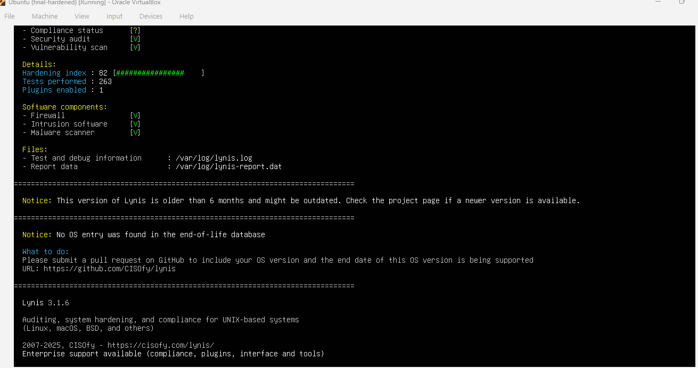

# Linux Server Hardening: Ubuntu 26.04

Hardening a fresh Ubuntu Server 26.04 install from a **Lynis hardening index of 63 to 82** (+19 points), with every change verified and documented.

## Results

| Measure | Before | After |
|---|---|---|
| Lynis hardening index | 63 | **82** |
| SSH password login | Default allowed | Refused (key only) |
| Firewall | Unconfigured | Active, default deny |
| Intrusion prevention | None | Fail2ban |
| Malware / integrity detection | None | rkhunter + AIDE |
| Security updates | 25 pending, manual | Applied, automatic |
| Audit logging | None | auditd rules on accounts, sudo, SSH |

## What was done

1. **SSH:** Ed25519 key authentication, password and root login disabled, forwarding disabled, session limits, verbose logging.
2. **Firewall (UFW):** default deny incoming, SSH rate limited, logging on.
3. **Fail2ban:** 3 failed logins in 10 minutes = 1 hour ban, enforced through UFW.
4. **Patching:** all updates applied, unattended-upgrades enabled.
5. **Detection:** rkhunter rootkit scanning, AIDE file integrity database, debsums.
6. **Kernel:** sysctl hardening against ICMP redirects, IP spoofing, SYN floods and kernel info leaks.
7. **Logging:** auditd rules, process accounting (acct), sysstat.
8. **Account policy:** 90-day password expiry, stronger hashing, umask 027, pwquality.
9. **Attack surface:** USB storage and unused protocols (DCCP, SCTP, RDS, TIPC) disabled, compilers restricted to root.
10. **Legal banner** on login.

Remaining Lynis suggestions were reviewed and documented as accepted, deferred or not applicable, with reasons, in the full report.

## Method

Measure, harden in phases, verify each control actually works, re-measure. Same Lynis version (3.1.6) for every scan, VirtualBox snapshots before each phase for rollback.

## Files

| File | Contents |
|---|---|
| `Linux-Hardening-Report.pdf` | Full report: findings, actions, results, residual risks, glossary |
| `01` to `14` `*.png` | Screenshot evidence for each step |
| `before-lynis.txt`, `after-lynis.txt`, `final-lynis.txt` | Raw audit outputs |
| `round2.sh` | Script used to apply the second hardening round |

## Tools

Lynis, OpenSSH, UFW, Fail2ban, unattended-upgrades, rkhunter, AIDE, auditd, sysctl

## About

Loay Essam, Networks Engineering student at the German University in Cairo, with system administration (Active Directory, Group Policy, Linux and Windows servers) and cybersecurity internship experience.

**Available for freelance work:** Linux and Windows server hardening, email security (SPF, DKIM, DMARC), website security checks.
